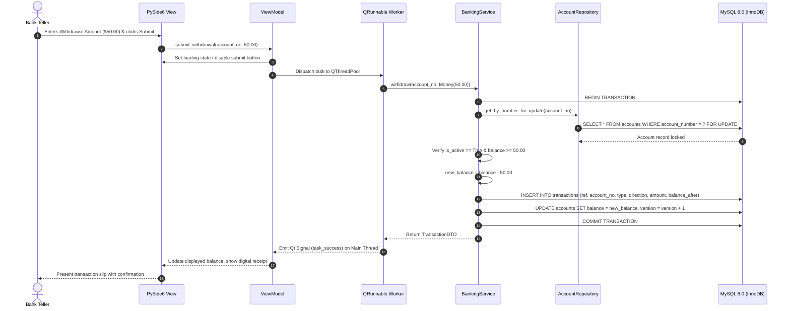
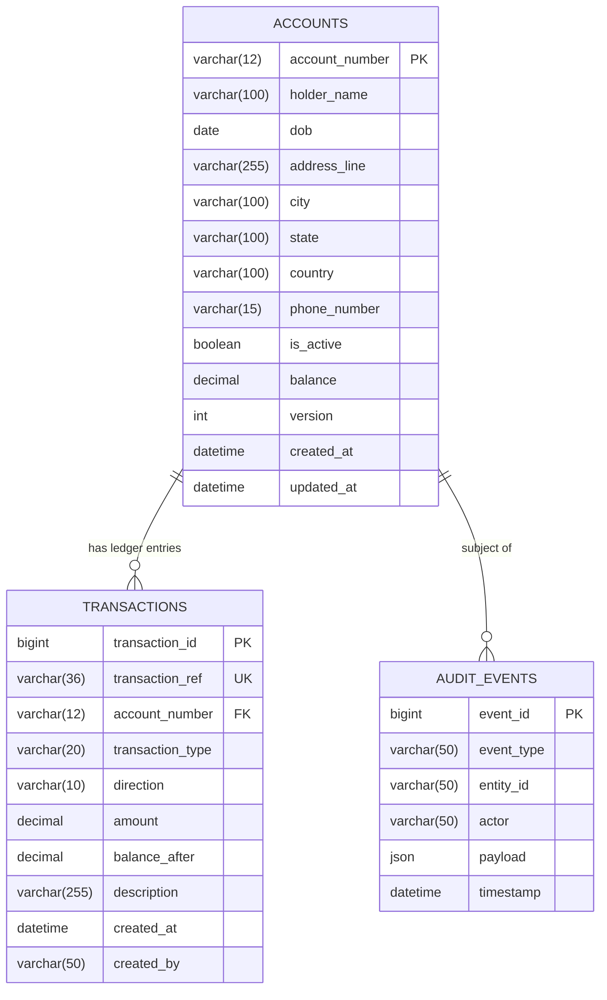

# Modern NovaBank (BMS) - System Architecture Document

## 1. Architectural Philosophy & Overview

The modernized NovaBank is designed as a secure, maintainable, and robust Windows desktop application adhering to **Clean Architecture / Hexagonal Architecture (Ports and Adapters)** principles. 

The architecture strictly isolates core financial business rules from user interface concerns, database technology, and external AI services.

```
+--------------------------------------------------------------------------+
|                         Presentation Layer (PySide6)                     |
|    Views (Qt Widgets) <---> ViewModels (Qt Signals/Slots) <---> Workers   |
+--------------------------------------------------------------------------+
                                     |
                                     v
+--------------------------------------------------------------------------+
|                         Application Layer (Services)                     |
|  BankingService | StatementService | AuditService | AIService | DTOs     |
+--------------------------------------------------------------------------+
                         |                           |
                         v                           v
+---------------------------------+         +------------------------------+
|     Domain Layer (Core)         |         | Infrastructure Layer         |
|  - Account, Transaction (Entities)|       | - SQLAlchemy ORM / PyMySQL   |
|  - Money, AccountNumber (VOs)   |<------->| - Alembic Migrations         |
|  - Repository Interfaces        |         | - LM Studio REST Client      |
|  - Domain Rules & Invariants    |         | - Windows Keyring / Config   |
+---------------------------------+         +------------------------------+
```

---

## 2. Layer Responsibilities & Module Boundaries

### 2.1 Domain Layer (`src/novabank/domain/`)
The heart of the application containing pure business logic and enterprise rules. It has **zero dependencies** on external libraries, frameworks, UI components, or databases.
- **Value Objects**:
  - `Money`: Immutable encapsulation of `decimal.Decimal` with 2 decimal places, preventing floating-point arithmetic errors.
  - `AccountNumber`: 12-digit account identifier with checksum validation and collision resistance.
  - `TransactionType`: Enumeration (`DEPOSIT`, `WITHDRAWAL`, `TRANSFER_IN`, `TRANSFER_OUT`, `FEE`, `INTEREST`).
  - `TransactionDirection`: Enumeration (`CREDIT`, `DEBIT`).
- **Entities**:
  - `Account`: Holds account profile, active status, current balance, and version token for optimistic concurrency.
  - `Transaction`: Immutable historical ledger entry with unique UUID reference, timestamp, direction, amount, post-transaction balance, and audit metadata.
- **Domain Exceptions**:
  - `InsufficientFundsError`, `AccountClosedError`, `AccountNotFoundError`, `InvalidAmountError`, `DuplicateTransactionRefError`.
- **Repository Ports (Interfaces)**:
  - Abstract base classes defining persistence contracts (`AccountRepositoryInterface`, `TransactionRepositoryInterface`, `AuditRepositoryInterface`).

### 2.2 Application Layer (`src/novabank/application/`)
Orchestrates use cases, coordinates domain entities, defines transaction boundaries, and mediates between presentation and persistence.
- **Services**:
  - `BankingService`: Handles atomic financial workflows: account opening, cash deposit, cash withdrawal, fund transfer, account profile modification, and account deactivation.
  - `StatementService`: Generates reconciled statements calculating opening balances, transaction breakdowns, and ending balances over arbitrary date intervals.
  - `AuditService`: Records compliance events for account creation, profile modifications, closures, and large transactions.
  - `AIService`: Manages privacy-sanitized interactions with the local AI assistant, translating natural language queries and generating statement narratives.
- **Data Transfer Objects (DTOs)**:
  - Strongly typed Pydantic models for exchanging data across layer boundaries without leaking domain entities.

### 2.3 Infrastructure Layer (`src/novabank/infrastructure/`)
Contains concrete implementations of repository interfaces, database connectivity, external service adapters, and OS integrations.
- **Persistence & ORM**:
  - `SQLAccountRepository` & `SQLTransactionRepository`: Implemented using SQLAlchemy 2.0 Core and ORM with strict parameter binding.
  - Database Driver: `PyMySQL` (pure Python) for universal compatibility without C compiler dependencies on Windows.
- **Database Migrations**:
  - `Alembic`: Manages versioned database schema upgrades and rollbacks.
- **Configuration & Secrets**:
  - `AppConfig`: `pydantic-settings` reading from environment variables, `.env` files, and Windows Credential Manager (`keyring`).
- **Local AI Client**:
  - `LMStudioClient`: HTTP REST adapter connecting to local LM Studio endpoint (`http://localhost:1234/v1`).
- **Reporting & File Export**:
  - `PDFStatementGenerator` (ReportLab / Qt QPrinter) and `CSVExporter`.

### 2.4 Presentation Layer (`src/novabank/ui/`)
Built with **PySide6 (Qt 6 for Python)**. Employs the **Model-View-ViewModel (MVVM)** pattern.
- **Views**:
  - QWidget and QMainWindow layouts: `MainWindow`, `DashboardView`, `OpenAccountView`, `AccountListView`, `AccountDetailView`, `DepositView`, `WithdrawalView`, `TransferView`, `StatementView`, `AuditLogView`, `AIAssistantPanel`.
- **ViewModels**:
  - Manages UI state, coordinates background task submission, processes validation feedback, and emits Qt signals to reactive widgets.
- **Threading & Workers**:
  - `TaskRunner`: Uses `QThreadPool` and `QRunnable` to offload all database, file I/O, and AI network requests from the Qt main GUI thread.

---

## 3. Data Flow Architecture



---

## 4. Database Schema & Transaction Design

### 4.1 Relational Schema Specification



### 4.2 Concurrency & Transaction Isolation
- **Storage Engine**: MySQL **InnoDB** with strict ACID semantics.
- **Transaction Isolation Level**: `READ COMMITTED`.
- **Row-Level Locking**: All balance-mutating operations execute `SELECT ... FOR UPDATE` on the affected account row(s).
- **Deadlock Prevention on Transfers**: During account-to-account transfers, locks on both accounts are acquired in deterministic alphabetical order by `account_number` (e.g. `min(acc1, acc2)` locked first, followed by `max(acc1, acc2)`).
- **Idempotency Guarantee**: Every financial mutation generates a client-side UUIDv4 `transaction_ref`. If network disruption or button re-clicking triggers a duplicate request, the unique database constraint on `transaction_ref` blocks duplicate insertion.

### 4.3 Legacy Data Migration Strategy
To protect historical data from the legacy console application without executing destructive scripts:
1. The legacy database `narDB` (with tables `BMS_MASTER` and `BMS_ACCOUNTS`) is treated as **read-only source data**.
2. A dedicated migration utility (`novabank.infrastructure.db.legacy_migrator`) performs an ETL (Extract, Transform, Load) process:
   - Reads all records from `narDB.BMS_MASTER` and maps them to `accounts`.
   - Reads historical rows from `narDB.BMS_ACCOUNTS`, reconstructs sequential transaction history, synthesizes unique UUIDs, validates credits and debits, and calculates the exact final running balance.
   - Verifies mathematical reconciliation: `SUM(credits) - SUM(debits) == final_balance`.
   - Generates an audit reconciliation report before writing to the new database.
3. Legacy tables are preserved untouched as an archive.

---

## 5. Local AI Integration & Trust Boundaries

The AI subsystem integrates with a locally running instance of **LM Studio** providing an OpenAI-compatible API (`http://localhost:1234/v1/chat/completions`). It is designed with uncompromising privacy and safety guardrails.

```
+-------------------------------------------------------------------------------+
|                             AI Trust Boundary                                 |
|                                                                               |
|   [Domain Data] ---> [Client-Side PII Sanitizer] ---> [Sanitized Prompt]      |
|                             |                                  |              |
|                   (Masks PII: Names, Addrs,                    v              |
|                    Phones, Account Digits)            [LM Studio: Local LLM]  |
|                                                                |              |
|   [Validated Domain Filter] <--- [Pydantic JSON Validator] <----+              |
|                                                                               |
|   * ZERO Direct DB Access       * ZERO Mutation Authority                     |
|   * Localhost Only (127.0.0.1)  * 100% Offline Fallback Available             |
+-------------------------------------------------------------------------------+
```

### 5.1 Architectural Trust Guardrails
1. **Zero Database Mutation Capability**: The AI subsystem has no connection, credentials, or tools to execute database mutations. It is strictly read-only and advisory.
2. **Client-Side PII Scrubbing**: Before constructing any prompt payload, customer data passes through `novabank.infrastructure.ai.sanitizer`:
   - Customer Name is replaced with `[Customer-Redacted]`.
   - Street Address is replaced with `[Address-Redacted]`.
   - Phone Number is replaced with `[Phone-Redacted]`.
   - Account Number is masked to display only the last 4 digits (`****-****-1234`).
3. **Structured Schema Validation**: All structured responses (such as natural-language query translations) are parsed into strict Pydantic schemas. If the model hallucinates unexpected fields, schema validation rejects the output and falls back to deterministic code.
4. **Local Sovereignty**: All AI network calls are constrained to `127.0.0.1` / `localhost`. No data leaves the local machine.
5. **Decoupled Offline Fallback**: If LM Studio is not running or encounters an error, the application seamlessly switches to offline mode with zero interruption to core banking operations.

---

## 6. Configuration & Security Architecture

### 6.1 Credential & Secrets Management
- The legacy practice of storing plaintext credentials in `BMS_MySQL_ConnectionString.csv` is completely abolished.
- Application configuration uses `pydantic-settings` to securely ingest configuration from:
  1. Operating system environment variables (`NOVABANK_DB_HOST`, `NOVABANK_DB_PORT`, `NOVABANK_DB_USER`, `NOVABANK_DB_PASSWORD`, `NOVABANK_DB_NAME`).
  2. Windows Credential Manager via the `keyring` library for desktop password storage.
  3. Local `.env.local` configuration file, strictly excluded from version control via `.gitignore`.
- Password strings are wrapped in Pydantic's `SecretStr` to prevent accidental logging or terminal leakage.

### 6.2 SQL Injection Immunity
- Manual SQL string concatenation and flawed string escaping (such as legacy `FormatString`) are entirely prohibited.
- 100% of database interactions are authored through SQLAlchemy 2.0 Core expression language or ORM queries with parameterized bind values.

### 6.3 Audit Trail & Compliance
- All administrative and financial events (account opening, customer contact updates, account closures, and large transactions) trigger immutable audit log entries in `audit_events`.
- Audit logs capture timestamp, actor, event category, entity ID, and before/after JSON diffs.
