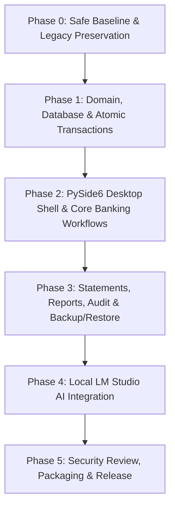

# NovaBank - Modern Desktop Banking System - Modernization Roadmap

## 1. Project Vision & Modernization Scope

### 1.1 Executive Summary
The NovaBank Modernization Project project transforms an existing Python 3.10 console-based banking script into an enterprise-grade, secure, modern Windows desktop application. The modernized application leverages **PySide6 (Qt 6)** for a high-performance, native Windows graphical user interface, **MySQL 8.0** with **SQLAlchemy 2.0** and **Alembic** for ACID-compliant, concurrency-safe relational persistence, and an optional **Local AI Assistant** integrated via **LM Studio** (OpenAI-compatible local REST endpoint) for natural language querying, statement summarization, and explainable activity monitoring without compromising customer privacy or data sovereignty.

### 1.2 Modernization Imperatives
The legacy system (`BMS.Py310.py` and `BMS_Tables.Py.310.py` in `C:\Github\BMS_CONSOLE-main`) demonstrates fundamental banking workflows but suffers from severe architectural, security, and operational defects that must be resolved:
1. **Destructive Database Scripts**: Legacy setup (`BMS_Tables.Py.310.py`) executes `DROP DATABASE IF EXISTS NARDB` and `DROP TABLE IF EXISTS ...` unconditionally upon execution, risking catastrophic production data loss.
2. **Critical Security Vulnerabilities**: Extensive SQL injection vulnerabilities through manual string replacement (`FormatString`), plaintext database credentials stored in an unencrypted CSV (`BMS_MySQL_ConnectionString.csv`), and zero authentication/access control.
3. **Severe Concurrency & Race Conditions**: Check-then-act balance calculations without row-level locking (`SELECT ... FOR UPDATE`), enabling double-spending in concurrent scenarios.
4. **Structural Data Defects**: The legacy transaction table (`BMS_ACCOUNTS`) lacks a primary key, transaction identifiers, transaction types, reference fields, and supports only integer currency values (`bigint`) without decimal precision.
5. **Brittle Control Flow**: Recursive function calls for input validation risking stack overflow (`RecursionError`), signal traps with infinite busy loops, and tight coupling between console I/O, SQL generation, and business rules.

The modernized project delivers a clean-room architectural overhaul following **Hexagonal/Clean Architecture** principles, preserving historical legacy data integrity while introducing professional desktop software standards.

---

## 2. Target Technology Stack

| Component | Target Technology | Rationale & Selection Criteria |
|---|---|---|
| **Language & Runtime** | Python 3.11 - 3.14 (64-bit) | Modern type hints, high performance, compatible with Windows runtime. |
| **Desktop UI Framework** | PySide6 (Qt 6 for Python) | Native Windows styling, robust Model-View-ViewModel (MVVM) support, high-DPI scaling, QThread worker pools. |
| **Database & Driver** | MySQL 8.0+ via PyMySQL / SQLAlchemy 2.0 | Pure-Python driver avoids MSVC compilation hurdles on modern Python; SQLAlchemy provides typed ORM & Core expressions. |
| **Schema Migrations** | Alembic | Version-controlled, safe, reversible schema evolution; eliminates destructive SQL scripts. |
| **Data Validation** | Pydantic v2 / Qt Validators | Deterministic domain schemas, input sanitization, and structured JSON parsing. |
| **Security & Secrets** | Windows Credential Manager (`keyring`) & `.env` | Secure OS-level credential vault; complete deprecation of plaintext CSV files. |
| **Local AI Engine** | LM Studio (Local Inference Server) | Local execution of open-weight models (e.g., Llama 3.2 3B/8B, Qwen 2.5 7B) via `http://localhost:1234/v1`; zero cloud data leakage. |
| **Testing & Quality** | pytest, pytest-qt, pytest-mock, pytest-cov | Automated unit, repository, concurrency, UI, and integration verification. |
| **Packaging & Release** | PyInstaller / Inno Setup | Self-contained Windows installer and portable standalone executable. |

---

## 3. Phased Modernization Roadmap

---

### Phase 0: Safe Baseline & Legacy Preservation (Priority P0)
**Objective**: Establish a secure development workspace, preserve legacy files intact, prevent destructive database scripts from executing, create safe configuration mechanisms, and establish baseline test infrastructure.

- **Milestone P0-M1: Workspace & Legacy Isolation**
  - Verify legacy source files (`BMS.Py310.py` and `BMS_Tables.Py.310.py`) in `C:\Github\BMS_CONSOLE-main` remain untouched and write-protected.
  - Initialize the modern project repository in `C:\Github\NovaBank` with comprehensive `.gitignore` and modern project structure (`pyproject.toml`, `src/novabank/`, `tests/`, `docs/`).
  - Configure Python virtual environment with base dependencies (`pydantic`, `SQLAlchemy`, `PyMySQL`, `alembic`, `pytest`, `keyring`).
  - *Acceptance Criteria*:
    - Legacy directory checksum matches original state.
    - New project initializes cleanly with virtual environment and passing health-check test.
    - Git repository initialized with appropriate ignore rules for `.env`, `*.csv`, `__pycache__`, and build artifacts.

- **Milestone P0-M2: Safe Configuration & Credential Store**
  - Implement `novabank.infrastructure.config` using `pydantic-settings` supporting environment variables and Windows Credential Manager via `keyring`.
  - Deprecate CSV credential storage; provide a secure one-way importer if a legacy `BMS_MySQL_ConnectionString.csv` is supplied by the user.
  - Implement a safe database connectivity tester that checks credentials and server availability without issuing DDL.
  - *Acceptance Criteria*:
    - Plaintext credential files are strictly ignored and forbidden from creation.
    - Configuration loads from OS environment, `.env.local` (gitignored), or Windows Credential Manager.
    - Database connectivity check validates MySQL 8.0 connection safely without creating or dropping databases.

---

### Phase 1: Core Domain, Database Schema & Atomic Transactions (Priority P1)
**Objective**: Construct the core domain model, professional MySQL schema with Alembic migrations, repository layer, monetary handling with decimal precision, ACID atomic transactions, and comprehensive automated test suites.

- **Milestone P1-M1: Monetary Rules & Domain Model**
  - Define domain value objects: `Money` (using Python `decimal.Decimal` with 2 decimal places, rounding `ROUND_HALF_UP`), `AccountNumber` (12-digit format with Luhn verification or checksum), `TransactionType` (ENUM: `DEPOSIT`, `WITHDRAWAL`, `TRANSFER_IN`, `TRANSFER_OUT`).
  - Define domain entities: `Account` (attributes: number, holder name, DOB, address, city, state, country, phone, active status, balance, created/updated timestamps, version for optimistic locking).
  - Implement domain rules: no negative balances, withdrawal limits, inactive account transaction prohibitions.
  - *Acceptance Criteria*:
    - Monetary arithmetic tested against floating-point inaccuracies (e.g., `0.1 + 0.2 == 0.30`).
    - Domain validation rejects invalid names, underage/future DOBs, invalid 10-digit phone numbers, and negative/zero transaction amounts.
    - 100% unit test coverage on core domain logic.

- **Milestone P1-M2: Database Schema & Migration Engine**
  - Design normalized MySQL schema:
    - `accounts`: `account_number` VARCHAR(12) PK, `holder_name` VARCHAR(100), `dob` DATE, `address_line` VARCHAR(255), `city` VARCHAR(100), `state` VARCHAR(100), `country` VARCHAR(100), `phone_number` VARCHAR(15), `is_active` BOOLEAN, `balance` DECIMAL(15, 2), `created_at` DATETIME, `updated_at` DATETIME, `version` INT.
    - `transactions`: `transaction_id` BIGINT AUTO_INCREMENT PK, `transaction_ref` VARCHAR(36) UNIQUE (UUIDv4), `account_number` VARCHAR(12) FK, `transaction_type` VARCHAR(20), `direction` VARCHAR(10), `amount` DECIMAL(15, 2), `balance_after` DECIMAL(15, 2), `description` VARCHAR(255), `created_at` DATETIME, `created_by` VARCHAR(50).
    - `audit_events`: `event_id` BIGINT AUTO_INCREMENT PK, `event_type` VARCHAR(50), `entity_id` VARCHAR(50), `actor` VARCHAR(50), `payload` JSON, `timestamp` DATETIME.
  - Configure Alembic for database versioning; write initial migration script.
  - Provide safe, non-destructive legacy migration script to import historical `narDB.BMS_MASTER` and `narDB.BMS_ACCOUNTS` records into the modern schema with synthesized UUIDs and verified running balances.
  - *Acceptance Criteria*:
    - Migration runs cleanly up and down on fresh MySQL 8.0 instance.
    - All tables enforce primary keys, foreign keys, and indexes (`account_number`, `created_at`).
    - Legacy migration script verified in a dry-run test without altering original tables.

- **Milestone P1-M3: Repository Layer & Atomic Transaction Engine**
  - Implement `AccountRepository` and `TransactionRepository` using SQLAlchemy Core/ORM with strictly parameterized queries.
  - Implement `BankingService` with atomic transaction boundaries:
    - Deposit: Begins transaction, locks account (`SELECT ... FOR UPDATE`), creates `transactions` record, updates account balance, commits.
    - Withdrawal: Begins transaction, locks account (`SELECT ... FOR UPDATE`), verifies active status, verifies `balance >= amount`, inserts transaction record, updates account balance, commits.
    - Rollback: Explicit rollback on any exception or constraint violation.
  - *Acceptance Criteria*:
    - Concurrency test simulates 10 simultaneous threads attempting to withdraw the same balance; exactly one succeeds and 9 fail with `InsufficientFundsError`. No overdrafts or double-spending occur.
    - Zero SQL string concatenation throughout the codebase.

---

### Phase 2: PySide6 Desktop Application Shell & Core Banking Workflows (Priority P2)
**Objective**: Build a modern, responsive Windows desktop GUI using PySide6 following the MVVM pattern with non-blocking worker threads.

- **Milestone P2-M1: Application Shell & Navigation**
  - Design main window (`MainWindow`) with fluent modern navigation sidebar: Dashboard, Accounts, Transactions, Statements, Reports, AI Assistant, and Settings.
  - Implement global status bar showing database connection health, active user/branch session, and AI service status.
  - Integrate Qt stylesheet (QSS) supporting light and dark themes optimized for Windows 10/11 high-DPI displays.
  - *Acceptance Criteria*:
    - Application launches under 2.0 seconds.
    - Responds to window resizing and high-DPI scaling (100% to 200%) without clipped text or visual defects.
    - Gracefully notifies user if MySQL is disconnected with reconnect dialog.

- **Milestone P2-M2: Customer & Account Management UI**
  - Build `OpenAccountView`: Form with fields for Customer Name, DOB (QDateEdit), Address, City, State, Country, Phone Number, and Optional Initial Deposit. Real-time field validation with visual indicators.
  - Build `AccountListView` & `AccountDetailView`: Searchable, paginated table of accounts (filter by Account No, Name, Phone, Status). View profile details, edit contact information, and close/deactivate accounts with confirmation dialog.
  - Thread worker integration: All database lookups and mutations execute via `QThreadPool` / `QRunnable` with Qt signals, preventing UI thread freezing.
  - *Acceptance Criteria*:
    - Account creation generates verified unique 12-digit account number.
    - Search responds dynamically with debounce under 100ms.
    - Form inputs strictly block invalid entries before submitting.
    - Account modification logs an audit event and updates table views reactively.

- **Milestone P2-M3: Cash Transactions UI (Deposit, Withdrawal & Transfer)**
  - Build `TransactionView`: Streamlined interfaces for Cash Deposit, Cash Withdrawal, and Account-to-Account Fund Transfer.
  - Real-time account verification: Displays current customer name, active status, and available balance upon entering account number.
  - Transaction confirmation dialog displays breakdown, fee (if any), and post-transaction balance.
  - Receipt generation view with option to print or save digital transaction slip.
  - *Acceptance Criteria*:
    - Withdrawal interface immediately prevents submission if entered amount exceeds available balance.
    - Transaction failure triggers clear, user-friendly error dialog with specific guidance (e.g. 'Account is inactive', 'Insufficient funds').
    - Successful transactions immediately update the displayed account balance and ledger view.

---

### Phase 3: Statements, Reports, Audit & Backup Procedures (Priority P3)
**Objective**: Implement comprehensive reporting, statement export, audit event logging, and safe operational backup/restore utilities.

- **Milestone P3-M1: Account Statements & PDF/CSV Export**
  - Build `StatementView`: Filter account transactions by date range (Today, Last 7 Days, This Month, Custom Range) and transaction type.
  - Interactive transaction table showing Transaction ID, Date/Time, Description, Debit, Credit, and Running Balance.
  - Export capabilities: Formatted PDF statement (with bank header and summary statistics) and standard CSV export.
  - *Acceptance Criteria*:
    - Statement calculates mathematically correct opening balance, period totals, and closing balance.
    - CSV export generates valid RFC-4180 compliant CSV.
    - PDF generation executes asynchronously on worker thread without freezing GUI.

- **Milestone P3-M2: Audit Event Logging & Compliance Viewer**
  - Implement automated audit interceptor: logs user actions (account created, details updated, account closed, large transactions).
  - Build `AuditLogView`: Read-only administrative viewer displaying event timestamps, actors, event categories, and change diffs.
  - *Acceptance Criteria*:
    - All account modifications and closures create immutable audit log entries.
    - Audit log viewer supports filtering by date, actor, and account number.

- **Milestone P3-M3: Safe Database Backup & Restore Utilities**
  - Implement automated MySQL backup utility invoking `mysqldump` with safe parameters (consistent read, single-transaction, routines, triggers).
  - Implement backup verification tool that checks backup file integrity and size.
  - Provide documented, interactive restore wizard with explicit confirmation safeguards against accidental overwrites.
  - *Acceptance Criteria*:
    - Backup completes cleanly into timestamped archive directory.
    - Restore wizard requires explicit text confirmation before touching database.
    - No destructive automatic actions.

---

### Phase 4: Local LM Studio AI Integration (Priority P4)
**Objective**: Enhance the desktop application with privacy-preserving, local AI capabilities powered by open-weight LLMs hosted in LM Studio.

- **Milestone P4-M1: LM Studio Client & Trust Boundary Architecture**
  - Implement `novabank.infrastructure.ai.LMStudioClient` communicating with `http://localhost:1234/v1/chat/completions`.
  - Establish strict **AI Trust Boundary**:
    - AI is strictly read-only and advisory.
    - AI has ZERO database write credentials or mutation capabilities.
    - Client-side PII sanitizer: Masks customer names, exact street addresses, and full phone numbers before sending context to the local model.
    - Health-check service: Automatically detects LM Studio availability and server status.
  - *Acceptance Criteria*:
    - If LM Studio is not running, the application gracefully disables AI features, displays 'AI Assistant: Offline', and operates with 100% normal banking functionality.
    - Sanitizer tests prove no raw customer PII enters LLM prompt payloads.
    - Network calls are strictly local (`127.0.0.1` / `localhost`); no external cloud traffic is generated.

- **Milestone P4-M2: Natural Language Transaction Queries & Statement Summaries**
  - Feature 1 - Smart Statement Summarizer: Generates human-readable financial summaries for selected statement periods (e.g., 'Total deposits: $4,500 across 3 transactions; Highest expense: $1,200 on 12/03').
  - Feature 2 - Natural Language Search Assistant: Translates user queries (e.g., 'Find deposits over 1000 from last month') into structured filter parameters validated by the application layer.
  - Output validation: All structured outputs are parsed and validated via Pydantic schemas; raw LLM text is never executed as SQL.
  - *Acceptance Criteria*:
    - Structured queries map strictly to validated query filters.
    - Invalid or hallucinatory responses are caught by schema validation and fall back to standard keyword search.
    - Streaming or background responses do not block the UI.

- **Milestone P4-M3: Rule-Based Activity Flag Explainer**
  - Business rules engine flags suspicious patterns (e.g., rapid consecutive withdrawals, transactions exceeding threshold, sudden activity on dormant accounts).
  - The AI assistant provides clear, explainable summaries of why a rule was triggered to aid bank tellers and branch managers.
  - *Acceptance Criteria*:
    - Rule flags are deterministically computed by Python business logic, NOT by the AI.
    - The AI's role is strictly confined to generating explanatory narrative context from the deterministic flag metadata.
    - Managers can accept or dismiss flags with audit logging.

---

### Phase 5: Hardening, Packaging, Documentation & Release (Priority P5)
**Objective**: Execute final security audits, integration and regression testing, standalone Windows packaging, comprehensive documentation, and release readiness.

- **Milestone P5-M1: Security Audit & Quality Hardening**
  - Run static security analysis (`bandit`, `safety`, `ruff`).
  - Verify complete elimination of SQL injection vectors, buffer overflows, and uncaught exceptions.
  - Execute stress and concurrency test suites with 50 concurrent transactions.
  - *Acceptance Criteria*:
    - Zero critical or high security issues reported.
    - Zero regressions across financial calculation test suites.
    - Test suite coverage exceeds 90% across domain and application layers.

- **Milestone P5-M2: Windows Packaging & Standalone Distribution**
  - Configure `PyInstaller` build script generating a clean, single-folder or standalone `.exe` distribution with all Qt dynamic libraries and icon assets.
  - Create Inno Setup installer script for Windows 10/11 with desktop shortcut, uninstaller, and prerequisite checks (MySQL 8.0, optional LM Studio).
  - *Acceptance Criteria*:
    - Clean installation and launch on a fresh Windows test environment without pre-installed Python.
    - Application uninstalls cleanly without leaving orphan registry keys or files.

- **Milestone P5-M3: Documentation & Portfolio Presentation**
  - Author comprehensive `README.md` with architectural diagrams, feature showcase, setup guides, and modernization case study.
  - Create developer documentation (`docs/DEVELOPER_GUIDE.md`), user manual (`docs/USER_MANUAL.md`), and database migration guide (`docs/MIGRATION_GUIDE.md`).
  - *Acceptance Criteria*:
    - Full documentation reviewed and verified against final build.
    - Clean repository presentation suitable for senior-level engineering portfolio evaluation.

---

## 4. Risks & Mitigations Matrix

| Risk ID | Risk Description | Severity | Probability | Mitigation Strategy |
|---|---|---|---|---|
| **RSK-01** | Total data loss from legacy destructive scripts (`BMS_Tables.Py.310.py` dropping `NARDB`). | Critical | Medium | Legacy scripts are strictly isolated in `C:\Github\BMS_CONSOLE-main` and marked read-only. The new project in `C:\Github\NovaBank` uses Alembic migrations with explicit safety checks prohibiting `DROP DATABASE`. |
| **RSK-02** | Double-spending / race conditions during concurrent withdrawals. | High | High | Implement row-level locking (`SELECT ... FOR UPDATE`) in MySQL InnoDB engine within strict database transactions, combined with account `version` optimistic locking checks. |
| **RSK-03** | PySide6 UI thread freeze during database queries or AI inference. | Medium | High | Enforce asynchronous execution: all database queries and HTTP calls to LM Studio execute on dedicated `QRunnable` worker threads managed by `QThreadPool`. |
| **RSK-04** | LM Studio service offline, slow, or model uninstalled. | Medium | High | Design optional, loosely coupled AI client with connection health-checks, 10-second timeouts, and automatic fallback to standard deterministic UI features. |
| **RSK-05** | Customer PII leak to AI model. | High | Low | Client-side sanitization layer automatically scrubs customer names, phone numbers, and full addresses before building prompt payloads. Local inference guarantees no external cloud transmission. |
| **RSK-06** | Incompatible Python environment or missing MSVC build tools for C-extensions (`mysqlclient`). | High | Medium | Use `PyMySQL` (pure Python) as the default database driver with SQLAlchemy, ensuring out-of-the-box compatibility across Python 3.11–3.14 on Windows. |
| **RSK-07** | Floating-point rounding errors in monetary calculations. | High | Medium | Enforce Python standard library `decimal.Decimal` and SQL `DECIMAL(15, 2)` throughout domain, database, and presentation layers. Floating-point types (`float`) are strictly forbidden for currency. |

---

## 5. Explicit Non-Goals & Deferred Scope

The following capabilities are explicitly deferred or designated as non-goals to maintain realistic engineering focus and deliver a rock-solid desktop application:
1. **Cloud AI / Commercial APIs**: OpenAI, Anthropic, or Google cloud APIs will NOT be integrated. The AI subsystem strictly targets local open-weight inference via LM Studio.
2. **Cloud Multi-Tenant SaaS**: The system is designed as a secure on-premise Windows desktop application for single-branch or local intranet banking, not a multi-tenant cloud SaaS.
3. **Automated AI Financial Decisions**: The AI assistant will NEVER be granted authority to execute, approve, or alter financial transactions or account states.
4. **Card / Payment Gateway Integration**: Real-world payment rails (Visa, Mastercard, SWIFT, ACH, UPI) are out of scope. Transactions represent cash counter operations and internal account transfers.
5. **Mobile Applications**: iOS and Android clients are out of scope; focus remains solely on modern Windows desktop (PySide6).

---

## 6. Current Project Status & Immediate Next Milestone

- **Current Status**: **Phase 0 (P0) - In Progress (Milestone P0-M1 Complete)**
- **Legacy Audit**: Completed. Critical vulnerabilities and schema defects documented.
- **Project Structure**: Modern project repository initialized at `C:\Github\NovaBank` with active `.venv` and verified clean architecture package layout.
- **Immediate Next Task**: **`TASK-P0-02`** - Establish Code Quality, Type Checking & Testing Infrastructure (or `TASK-P0-03` - Implement Secure Configuration & Credential Store).
